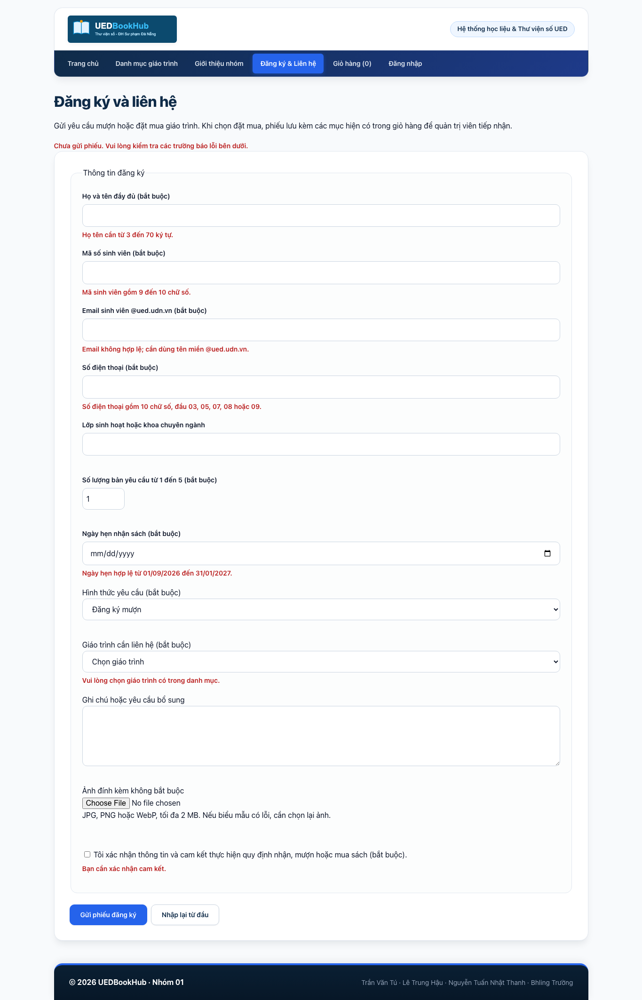
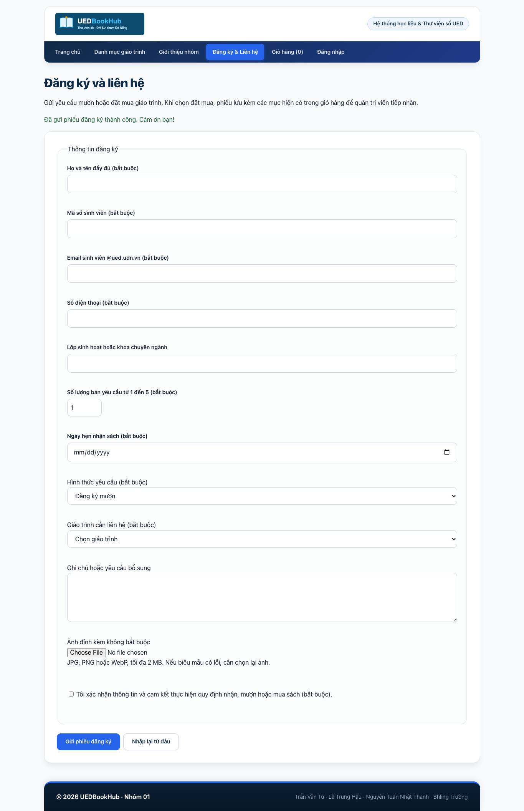
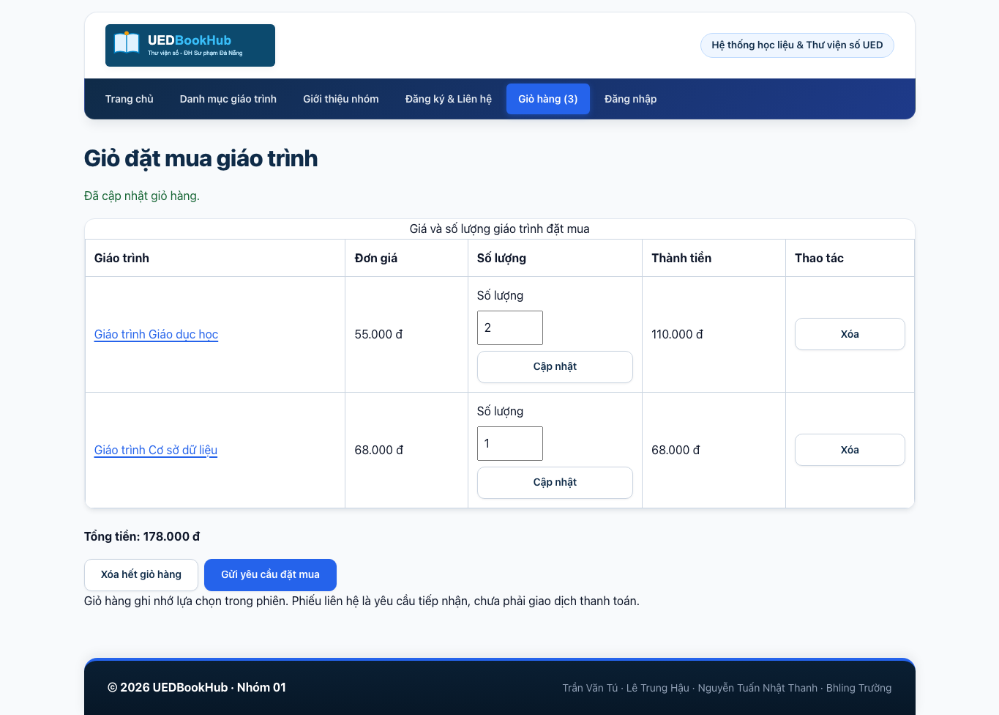
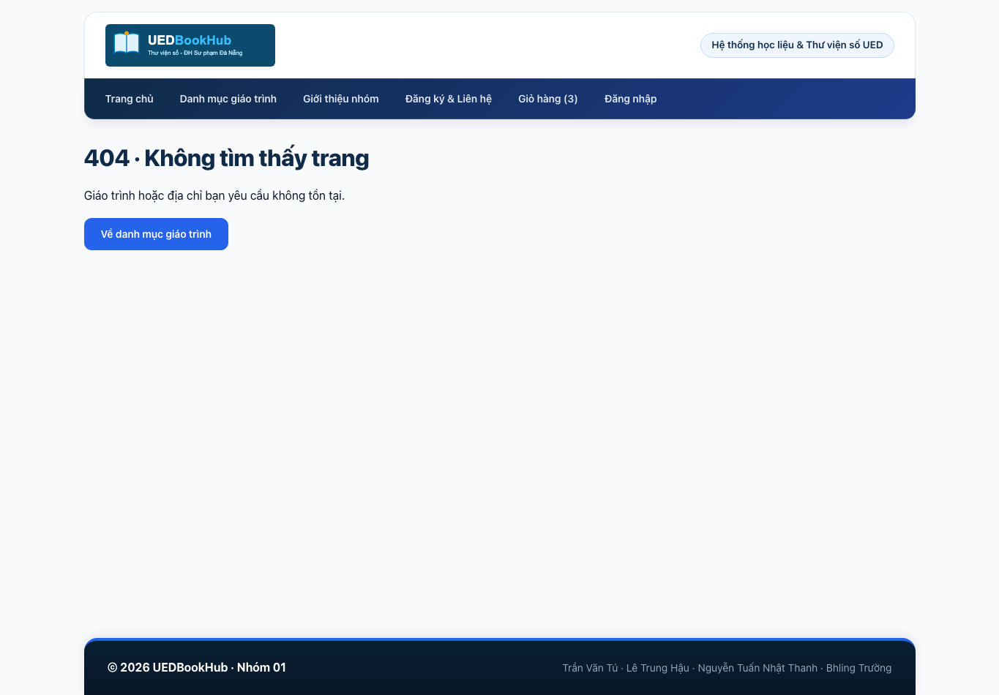
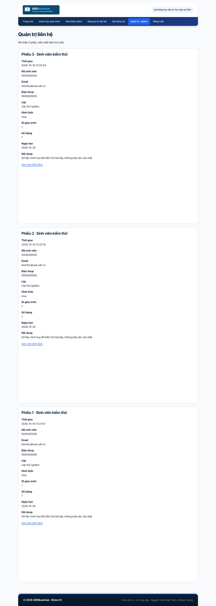

# Báo cáo bài tập nhóm số 5 UEDBookHub

Chương 5 Lập trình PHP phía máy chủ. Nhóm 01 chuyển website UEDBookHub sang PHP thuần, sử dụng giỏ hàng để đặt mua giáo trình. Nội dung này gồm Phần A, Phần C, minh chứng kiểm thử và bảng phân công; trang bìa do nhóm bổ sung. Phần B cá nhân nằm ngoài phạm vi chuẩn bị lần này.

Kho mã nguồn: https://github.com/TuQNgaiDev/LTWeb-DoAn-Nhom01. Mốc bài 4: btn4 tại 251790a5475b9926a083e0fb0d90d1b3dcd9a824 theo xác nhận của trưởng nhóm. Thẻ mới được tạo cục bộ, chưa push. Mã commit PHP cuối: CHƯA CÓ, nhóm điền sau khi rà soát và commit bản nộp. Không dùng mã mốc bài 4 thay cho mã commit cuối.

Danh sách thành viên

| Họ và tên | Mã sinh viên | GitHub |
| --- | --- | --- |
| Trần Văn Tú | 3120224169 | TuQNgaiDev |
| Lê Trung Hậu | 3120224052 | Lehau290 |
| Nguyễn Tuấn Nhật Thanh | 3120224132 | NTNThanh0609 |
| Bhling Trường | 3120124040 | truongcutecute |

## Phần A

### Website động bằng PHP cho đồ án

Năm trang chính được đổi tên từ .html sang .php bằng git mv. Máy chủ tạo sẵn danh sách và chi tiết từ data/giao-trinh.json; bộ lọc dùng GET, biểu mẫu và giỏ dùng POST. Tất cả sáu chức năng của Bảng 1 hoạt động khi tắt JavaScript. Menu thu gọn, yêu thích localStorage và khối thời tiết Open-Meteo được giữ như phần tăng cường.

inc/config.php được nạp trước output để cấu hình E_ALL, log, Composer và session. Header, menu và footer chỉ có một bản trong inc/. Các trang tách xử lý ở đầu và hiển thị phía dưới, dùng foreach thay vì nối HTML trong controller. Hàm e() dùng htmlspecialchars với ENT_QUOTES và ENT_SUBSTITUTE, UTF-8 [1].

Bảng 1 Sáu chức năng bắt buộc

| TT | Trang | Chức năng | Kỹ thuật bắt buộc | Tệp PHP | Người phụ trách |
| --- | --- | --- | --- | --- | --- |
| 1 | Mọi trang | Khung chung, menu hiện hành, số cuốn, người đăng nhập; trang lỗi. | require, __DIR__, $tieuDe, $trang, $goc; HTTP 404 và 500. | inc/config.php; inc/header.php; inc/footer.php; 404.php; 500.php | Lê Trung Hậu |
| 2 | danh-sach | Danh sách, tìm, lọc khoa, sắp xếp; giữ lựa chọn. | GET, danh sách cho phép; array_filter, usort, mb_stripos. | danh-sach.php; src/Data/KhoGiaoTrinh.php | Nguyễn Tuấn Nhật Thanh |
| 3 | chi-tiet; index | Chi tiết theo ID, thêm giỏ; bốn mục đã xem. | filter_var; cookie HttpOnly, SameSite; kiểm tra khi đọc. | chi-tiet.php; index.php; inc/ham.php | Bhling Trường |
| 4 | lien-he | Kiểm tra, điền lại, báo lỗi; ảnh tùy chọn; lưu phiếu. | trim, độ dài, email, regex; finfo; tên ảnh ngẫu nhiên; JSONL, PRG, flash. | lien-he.php; src/Services/KiemTraLienHe.php; src/Data/KhoLienHe.php | Trần Văn Tú |
| 5 | gio-hang | Thêm, sửa số lượng, xóa mục, xóa hết; tính tổng. | GioHang bọc session; số nguyên 1–99; ID và giá từ kho; PRG. | gio-hang.php; src/Services/GioHang.php | Trần Văn Tú |
| 6 | Đăng nhập; quản trị | Đăng nhập, xem phiếu kèm ảnh mới nhất trước, đăng xuất. | password_hash, password_verify; đổi SID; bao-ve; log đăng nhập sai. | dang-nhap.php; dang-xuat.php; quan-tri.php; inc/bao-ve.php; inc/tai-khoan.php | Trần Văn Tú |

Phân công trên là trách nhiệm đã được trưởng nhóm xác nhận. Lịch sử commit riêng và tỷ lệ đóng góp thực tế phải được nhóm hoàn thiện; bảng này không thay thế bằng chứng đóng góp.

Bảng 2 Các lớp PHP của nhóm

| TT | Lớp và tệp | Thuộc tính và phương thức chính | Dùng ở trang |
| --- | --- | --- | --- |
| 1 | App\Models\GiaoTrinh<br>src/Models/GiaoTrinh.php | 13 thuộc tính readonly: id, ma, ten, tacGia, khoa, namXuatBan, nhaXuatBan, gia, giaGoc, soLuong, soTrang, anh, moTa; tuMang(array): self. | Trang chủ, danh sách, chi tiết, giỏ |
| 2 | App\Data\KhoGiaoTrinh<br>src/Data/KhoGiaoTrinh.php | tatCa(): array; timTheoId(int): ?GiaoTrinh; cacKhoa(): array; timKiem(string, string, string): array; cache mỗi request. | Trang chủ, danh sách, chi tiết, giỏ, liên hệ |
| 3 | App\Services\GioHang<br>src/Services/GioHang.php | cacMuc(); them(); capNhat(); xoa(); xoaHet(); soMon(): int; tongTien(KhoGiaoTrinh): int. | Giỏ, header, liên hệ |
| 4 | App\Data\KhoLienHe<br>src/Data/KhoLienHe.php | them(array): void; tatCa(): array; ghi JSONL có LOCK_EX, đọc có LOCK_SH; mới nhất trước. | Liên hệ, quản trị |
| 5 | App\Services\KiemTraLienHe<br>src/Services/KiemTraLienHe.php | kiemTra(array, array, KhoGiaoTrinh): array trả $du, $loi, thông tin ảnh hợp lệ. | Liên hệ |

### Cách hoạt động của các chức năng

Khung trang: mọi trang require cấu hình trước, gán tiêu đề và tên menu, rồi require header/footer. Header dùng aria-current cho trang đang mở; số bên cạnh giỏ là tổng số cuốn. 404.php và 500.php trả đúng mã HTTP. Ở prod, exception handler ghi chi tiết vào logs/php-error.log và trả trang lỗi không lộ đường dẫn. Nộp bài với dev.

Danh sách: danh-sach.php đọc q, dm, sx; kiểm tra chuỗi, giới hạn từ khóa 150 ký tự, đối chiếu khoa và kiểu sắp xếp. KhoGiaoTrinh lọc tên/mã/tác giả bằng mb_stripos, lọc khoa bằng array_filter và sắp xếp bằng usort. Ô tìm và select giữ lại lựa chọn; khi rỗng hiện thông báo. Tìm kiếm không phân biệt hoa thường nhưng phân biệt dấu, khác tính năng bỏ dấu ở bản JavaScript trước.

Chi tiết và đã xem: filter_var thông qua soNguyen() chỉ chấp nhận ID nguyên dương có trong kho; thiếu/sai ID trả 404. Cookie da_xem có tối đa bốn ID không trùng, mới nhất trước, tồn tại 30 ngày. Giá trị cookie được kiểm tra lại và đối chiếu kho mỗi lần đọc; cookie giả bị bỏ qua. Cookie HttpOnly, SameSite=Lax và Secure khi dùng HTTPS; ghi trước output.

Liên hệ: giữ các trường của bài 4 và kiểm tra lại toàn bộ phía máy chủ. Họ tên 3–70 ký tự; MSSV 9–10 chữ số; email hợp lệ thuộc @ued.udn.vn; SĐT đúng regex; lớp tối đa 100 ký tự; hình thức mua/mượn thuộc danh sách; giáo trình phải tồn tại; số lượng 1–5 không vượt kho; ngày hợp lệ trong 01/09/2026–31/01/2027; ghi chú tối đa 2000 ký tự; cam kết bắt buộc. Khi lỗi, biểu mẫu giữ dữ liệu chữ và báo lỗi dưới từng ô. Input file phải chọn lại theo quy tắc trình duyệt.

Ảnh tùy chọn tối đa 2 MB. Máy chủ xét mã lỗi upload, kích thước, is_uploaded_file, MIME thật bằng finfo và chữ ký ảnh; chỉ nhận JPG/PNG/WebP. Tên ngẫu nhiên từ random_bytes, không dùng tên do khách gửi. Chỉ move_uploaded_file khi mọi ô hợp lệ. Nếu ghi phiếu thất bại, ảnh vừa lưu được xóa để tránh tệp mồ côi. Phiếu lưu JSONL có khóa tệp; thành công trả 302 về lien-he.php và hiện flash đúng một lần [2].

Giỏ đặt mua: GioHang quản lý $_SESSION[gio] theo ID và số lượng. Máy chủ không lấy giá từ POST; giá và tên từ KhoGiaoTrinh. Số lượng phải là số nguyên 1–99, không vượt số bản hiện có, kể cả tổng khi thêm trùng. Người dùng thêm, đổi số lượng, xóa một mục, xóa hết; thành tiền và tổng được tính lại trên máy chủ. Khi gửi phiếu hình thức mua, ứng dụng lưu kèm bản chụp giỏ tại thời điểm gửi. Bài này chưa triển khai thanh toán hoặc hệ thống trạng thái đơn hàng.

Đăng nhập và quản trị: tài khoản thử admin với mật khẩu minh họa UEDDemo2026!, trong mã chỉ lưu hash. password_verify kiểm tra mật khẩu; thành công gọi session_regenerate_id(true), lưu user và chuyển sang quản trị [3]. Sai thông tin trả cùng một thông báo chung và ghi log không chứa mật khẩu. inc/bao-ve.php chuyển khách về trang đăng nhập. Quản trị liệt kê phiếu mới nhất trước, escape nội dung và hiện ảnh tên hợp lệ. Đăng xuất xóa session và cookie phiên, vì vậy giỏ của phiên cũng kết thúc.

### Ảnh minh chứng chức năng

Tất cả dữ liệu trong ảnh là dữ liệu kiểm thử tổng hợp. Ảnh gốc đọc được chữ nằm trong kiemtra/btn5; hình trong báo cáo được cắt phần cần minh họa để không thu nhỏ toàn bộ biểu mẫu dài.


Hình 1 Biểu mẫu báo lỗi ở máy chủ sau khi bỏ qua kiểm tra trình duyệt


Hình 2 Thông báo gửi thành công sau chuỗi POST 302 GET


Hình 3 Giỏ gồm hai giáo trình với số lượng và tổng tiền từ máy chủ


Hình 4 Trang 404 khi ID không hợp lệ


Hình 5 Trang quản trị hiển thị phiếu mới nhất trước và ảnh đính kèm

### Kiểm thử phía máy chủ

Kiểm thử ngày 16/10/2026 trên macOS, PHP 8.5.10, Composer 2, Chrome/Chromium. Script tests/kiem-thu.py dùng bản sao tạm và HTTP trực tiếp, không phụ thuộc JavaScript; kết quả tại tests/ket-qua/ket-qua-http.json. Cấu hình ứng dụng vẫn tương thích cú pháp PHP 8.1 nhưng chưa chạy bộ kiểm thử bằng binary 8.1 trên máy này.

Bảng 3 Kiểm thử phía máy chủ

| TT | Ca kiểm thử | Kết quả mong đợi | Kết quả thực tế | Đạt |
| --- | --- | --- | --- | --- |
| 1 | Gửi liên hệ rỗng | Lỗi từng ô bắt buộc; không lưu. | POST rỗng: lỗi từng trường bắt buộc, không lưu. | Có |
| 2 | Email lan@ued, SĐT abc | Đúng hai lỗi; giữ ô hợp lệ. | Sai email và SĐT: đúng hai thông báo, giữ họ tên và lớp. | Có |
| 3 | Tệp PHP đổi đuôi JPG | Từ chối; không có ảnh mới. | Tệp PHP giả JPG bị từ chối; uploads không có tệp mới. | Có |
| 4 | Ảnh lớn hơn 2 MB | Báo kích thước; giữ dữ liệu; không Warning. | Ảnh trên 2 MB bị chặn; giữ dữ liệu, không Warning. | Có |
| 5 | Gửi hợp lệ rồi GET lại | Một dòng JSONL; flash một lần. | Gửi hợp lệ có ảnh: một dòng JSONL; GET lại không lưu trùng, flash chỉ một lần. | Có |
| 6 | XSS ở tìm kiếm và nội dung | Hiện chữ; không tạo thẻ script. | Tìm kiếm và nội dung quản trị escape chuỗi XSS. | Có |
| 7 | ID chữ, lạ hoặc không có | HTTP 404 thân thiện; không Warning. | ID chữ, không tồn tại và thiếu ID đều HTTP 404. | Có |
| 8 | SL 0, -3, 1000; ID lạ | Không thêm, giỏ giữ nguyên. | SL 0, -3, 1000 và ID lạ: báo lỗi, giỏ giữ trống. | Có |
| 9 | Thêm hai mục, sửa, xóa, tải lại | Thành tiền, tổng và header đúng. | Hai mục: tổng 233.000đ sau cập nhật; xóa mục 2 còn 165.000đ và header 3. | Có |
| 10 | Bảo vệ quản trị và đăng nhập | Chặn khách, lỗi chung, đổi SID, đăng xuất có hiệu lực. | Chặn khách, báo lỗi chung; đăng nhập đổi SID; đăng xuất không vào lại quản trị. | Có |
| 11 | Cookie abc,-1,999999 | Bỏ qua giá trị lạ; trang chủ bình thường. | Cookie abc,-1,999999 bị bỏ qua, trang chủ 200 không Warning. | Có |
| 12 | Prod và JSON tạm thiếu | HTTP 500 không lộ nội bộ; log có chi tiết. | Prod thiếu JSON: HTTP 500, không lộ đường dẫn; chi tiết ghi vào log. | Có |

Bổ sung: GET/POST kiểu mảng không gây Warning; cookie xem lần lượt 1,2,3,4,5,3 thu được 3,5,4,2; xóa hết giỏ thành công. Hai cảnh báo cố ý được tách rõ: log có ngoại lệ khi tạm giấu JSON và Warning khi thêm output trước header chỉ trong bản thử nghiệm. Không đưa log lỗi thử nghiệm vào logs/ của bản nộp.

Bảng 4 Chất lượng từng trang

| Trang | Lỗi PHP | Lỗi HTML | A11y | Tắt JS | Ghi chú |
| --- | --- | --- | --- | --- | --- |
| index.php | 0 | 0 | 100 | Có | 360 px, không tràn ngang (360 px). |
| danh-sach.php | 0 | 0 | 100 | Có | 360 px, không tràn ngang (360 px). |
| chi-tiet.php?id=1 | 0 | 0 | Không đo | Có | 360 px, không tràn ngang (360 px). |
| gio-hang.php | 0 | 0 | Không đo | Có | 360 px, không tràn ngang (360 px). |
| lien-he.php | 0 | 0 | 100 | Có | 360 px, không tràn ngang (360 px). |
| dang-nhap.php | 0 | 0 | Không đo | Có | 360 px, không tràn ngang (360 px). |
| quan-tri.php | 0 | 0 | Không đo | Có | 360 px, không tràn ngang (360 px). |
| gioi-thieu.php | 0 | 0 | Không đo | Có | 360 px, không tràn ngang (360 px). |

Lỗi PHP trong Bảng 4 là Warning/Notice/Deprecated khi tải và thao tác bình thường, không tính ngoại lệ được chủ động gây ra ở ca 12 và Phần C. HTML được gửi trực tiếp dưới dạng văn bản HTML do PHP sinh tới W3C Nu Validator; tất cả tám trang đạt 0 lỗi. Lighthouse Mobile Accessibility trên index.php, danh-sach.php và lien-he.php đều 100/100; các trang còn lại ghi Không đo, không suy diễn điểm. Tám trang được mở ở 360 px với JavaScript tắt; form GET, form POST, thêm giỏ, gửi phiếu và đăng nhập đều đã thao tác thành công.

Kiểm tra thêm đường dẫn /ltweb-doan-nhom01/ bằng PHP server: trang tải 200, CSS dùng URL tương đối, giỏ chuyển hướng đúng và cookie có path /ltweb-doan-nhom01/. Chưa chạy trực tiếp Apache/XAMPP trên máy này. Hai thư mục storage/ và logs/ có .htaccess Require all denied để Apache chặn URL; PHP development server không áp dụng .htaccess, vì vậy chỉ dùng trên localhost trong bài tập.

## Phần B

Chức năng PHP trên trang cá nhân của từng thành viên không thuộc phạm vi thực hiện theo yêu cầu của trưởng nhóm. Không ghi kết quả hoặc số commit cá nhân vào Bảng 5 khi chưa có minh chứng. Các trang cá nhân được giữ .html, chỉ sửa liên kết về trang PHP chính; thành viên tự bổ sung phần này trước khi nộp báo cáo đầy đủ.

## Phần C

### Câu 1 Máy chủ không tin trình duyệt

Request curl vượt qua HTML và JavaScript vẫn bị máy chủ kiểm tra. POST ho_ten=A&email_sv=abc nhận HTTP 200 với biểu mẫu báo lỗi, không thêm dòng liên hệ. Tại src/Services/KiemTraLienHe.php dòng 18, mb_strlen chặn tên quá ngắn; FILTER_VALIDATE_EMAIL và đuôi email chặn email sai. POST giỏ so_luong=-3 bị soNguyen(..., 1, 99) ở gio-hang.php dòng 13 từ chối, giỏ không đổi. Tất cả trường bài 4 nay được kiểm tra độc lập trên server: rỗng, kiểu, độ dài, định dạng và logic ID/số lượng. D3 bài 4 còn nhắc Prepared Statements; bài 5 chỉ dùng JSON nên chưa có SQL để áp dụng. Khi chuyển MySQL, PDO prepared statements mới xử lý phần này. e() phòng XSS khi xuất HTML, không thay thế kiểm tra nghiệp vụ hoặc truy vấn có tham số.

```sh
curl -i -d "ho_ten=A&email_sv=abc" http://localhost:8000/lien-he.php
curl -i -c cookie.txt -b cookie.txt -d "hanh_dong=them&id=1&so_luong=-3" http://localhost:8000/gio-hang.php
```

Kết quả đáng chú ý: HTTP/1.1 200 OK; Họ tên cần từ 3 đến 70 ký tự; Email không hợp lệ; Số lượng phải là số nguyên từ 1 đến 99; giỏ hàng đang trống. Tên trường được dùng theo form thật của nhóm, không dùng nguyên hoten/email của ví dụ đề. Bản phản hồi đầy đủ: tests/ket-qua/curl-thuc-nghiem.txt.

### Câu 2 Escape dữ liệu khi xuất HTML

Ba vị trí cụ thể là value của ô tìm kiếm ở danh-sach.php dòng 22; dữ liệu điền lại input ở lien-he.php dòng 53; nội dung phiếu ở quan-tri.php dòng 13. e() chuyển dấu nháy, dấu nhỏ hơn, lớn hơn và & thành thực thể HTML, giữ chuỗi ở dạng dữ liệu trong văn bản/thuộc tính [1]. Bản sao thử nghiệm tạm bỏ e() khỏi value, rồi gửi chuỗi "><script>alert(1)</script>: Chromium hiện hộp thoại alert với nội dung 1, vì dấu nháy đóng thuộc tính value và tạo thẻ script thật. Kết quả lưu trong tests/ket-qua/thu-nghiem-trinh-duyet.json. Với mã chuẩn, phản hồi là &quot;&gt;&lt;script&gt;alert(1)&lt;/script&gt;, không tạo script. Nếu quản trị in ghi chú không escape, mã độc được lưu rồi chạy khi quản trị viên xem phiếu, có thể thao tác dưới quyền phiên của họ. HttpOnly ngăn đọc cookie bằng JavaScript nhưng không ngăn script gửi yêu cầu cùng phiên. Bản lỗi chỉ tồn tại trong bản sao tạm và đã được khôi phục, không đưa vào mã nộp.

### Câu 3 PRG và thứ tự output

Ở bản sao tạm, bỏ chuyenHuong sau lưu liên hệ rồi gửi form và gọi reload bằng Playwright trên Chromium: số dòng JSONL tăng từ 1 lên 2. Chromium trong phép tự động hóa này gửi lại POST mà không phát dialog. Với thao tác F5 thông thường, trình duyệt có thể hỏi xác nhận gửi lại dữ liệu; hành vi hộp thoại phụ thuộc trình duyệt và cách tải lại. Phép thử HTTP hai POST cùng nội dung cũng tạo hai dòng. Với mã chuẩn, POST thành công trả 302 Location: lien-he.php, sau đó GET hiển thị flash; F5 lặp GET nên không thêm dòng. Bộ kiểm thử đã xác nhận gửi hợp lệ có ảnh chỉ thêm một dòng và flash chỉ hiện một lần. Khi chèn dòng trống trước <?php của chi-tiet.php và chạy output_buffering=0, phản hồi có Cannot modify header information và headers already sent; không có Set-Cookie da_xem. Session cũng cảnh báo vì header đã gửi. Bộ đệm output có thể che lỗi trên một cấu hình, còn cấu hình khác gửi output ngay; vì vậy không được dựa vào việc chỉ chạy đúng trên máy mình.

```sh
php -d output_buffering=0 -S localhost:8000
# Chỉ thêm dòng trống trên bản sao để thử, sau đó khôi phục.
# Quan sát: headers already sent; Set-Cookie da_xem không được gửi.
```

### Câu 4 Trạng thái giữa các request

Website lưu trạng thái ở nhiều nơi vì nhu cầu và thời gian sống khác nhau. Bảng dưới phân biệt dữ liệu nằm ở trình duyệt và dữ liệu máy chủ quản lý. Session giữ dữ liệu thật ở máy chủ; PHPSESSID là khóa nhận diện phiên trong cookie. Trình duyệt khác thường có cookie khác nên nhận giỏ mới. Xóa PHPSESSID làm mất liên kết tới giỏ cũ, không có nghĩa dữ liệu session cũ lập tức bị xóa vật lý. Khi sang Chương 6, nên đưa giáo trình, tài khoản, liên hệ, yêu cầu đặt mua và metadata ảnh vào MySQL; ảnh có thể tiếp tục lưu ở hệ thống tệp. Giỏ của khách và flash vẫn phù hợp với session; giỏ cần đồng bộ nhiều thiết bị thì thêm bảng giỏ theo tài khoản. Các trang dùng kho không cần đổi cách gọi nếu giữ giao diện; chủ yếu sửa KhoGiaoTrinh, KhoLienHe và cấu hình kết nối, đồng thời thay nguồn tài khoản thử khi triển khai tài khoản trong CSDL.

Dữ liệu được ghi nhớ giữa các request

| Dữ liệu | Nơi lưu | Ai đọc hoặc sửa | Mất đi khi nào |
| --- | --- | --- | --- |
| Giỏ đặt mua | $_SESSION[gio] trên máy chủ | PHP đọc/sửa sau kiểm tra; trình duyệt chỉ gửi yêu cầu. | Phiên hết hạn hoặc đăng xuất; xóa PHPSESSID tạo phiên mới. |
| Người đăng nhập | $_SESSION[user] | Máy chủ sau password_verify; không lấy tên từ cookie tùy ý. | Đăng xuất hoặc phiên hết hạn. |
| Mã phiên | Cookie PHPSESSID | Trình duyệt quản lý/gửi; JS không đọc do HttpOnly. | Hết phiên hoặc xóa cookie; server có thể còn dữ liệu cũ. |
| Flash | $_SESSION[flash] | Máy chủ tạo sau POST và lấy ở GET. | Bị unset ngay sau một lần đọc. |
| Bốn mục đã xem | Cookie da_xem | Máy chủ ghi, người dùng vẫn có thể sửa bằng DevTools; PHP kiểm tra lại. | Sau 30 ngày hoặc xóa cookie. |
| Yêu thích | localStorage uedBookHubYeuThich | JS và người dùng trên cùng origin; PHP không tự đọc. | Xóa site data hoặc tự bỏ yêu thích; không đồng bộ trình duyệt khác. |
| Phiếu và giỏ chụp lúc gửi | storage/lien-he.jsonl | Máy chủ ghi, quản trị đọc sau đăng nhập; Apache chặn URL trực tiếp. | Khi xóa/di chuyển tệp; không mất vì đăng xuất. |
| Ảnh đính kèm | uploads/ tên ngẫu nhiên | Máy chủ nhận ảnh hợp lệ; người biết URL ảnh có thể tải ảnh. | Khi xóa tệp; ảnh không tự mất theo session. |
| Giáo trình | data/giao-trinh.json | Lớp KhoGiaoTrinh đọc; người có quyền sửa mã/tệp có thể sửa. | Đến khi tệp được thay hoặc xóa. |
| Lỗi và lần đăng nhập sai | logs/php-error.log | PHP ghi, người có quyền máy chủ đọc; Apache chặn URL. | Khi quản trị xóa hoặc xoay log. |

## Tài liệu tham khảo

[1] PHP Manual. htmlspecialchars. https://www.php.net/manual/en/function.htmlspecialchars.php. Truy cập 16/10/2026.

[2] PHP Manual. Handling file uploads. https://www.php.net/manual/en/features.file-upload.php. Truy cập 16/10/2026.

[3] PHP Manual. session_regenerate_id. https://www.php.net/manual/en/function.session-regenerate-id.php. Truy cập 16/10/2026.

[4] Composer. Basic usage và Autoloading. https://getcomposer.org/doc/01-basic-usage.md. Truy cập 16/10/2026.

[5] Đề Bài tập thực hành nhóm số 5 Chương 5, học phần Thiết kế và Lập trình web, HK1 năm học 2026–2027, Khoa Toán–Tin, Trường ĐH Sư phạm–ĐH Đà Nẵng. Dùng yêu cầu và Phụ lục B làm gợi ý cấu trúc.

[6] Nhóm 01. Báo cáo Bài tập nhóm số 4, Nhom01_Baitap4.pdf. Dùng cấu trúc dữ liệu và câu D3 trang 19–20 để đối chiếu kiểm tra phía máy chủ.

Composer chỉ dùng cho autoload PSR-4 App\ sang src/, không cài framework hoặc thư viện làm thay sáu chức năng [4]. Các hàm PHP trong bài do nhóm cần đọc và giải thích được theo hướng dẫn học phần.

### Khai báo sử dụng AI

Codex hỗ trợ chuyển trang sang PHP, thiết kế lớp dữ liệu và giỏ, viết kiểm tra biểu mẫu/upload, xây dựng script kiểm thử, phân tích kết quả và soạn nội dung báo cáo Word. Các tên thành viên và phân công do trưởng nhóm cung cấp. Các số đo HTTP, W3C và Lighthouse được lấy từ lần chạy thực tế; không suy diễn số commit hoặc mức đóng góp cá nhân. Mỗi thành viên cần rà soát, chạy lại và hiểu phần được giao trước khi xác nhận và nộp bài.

## Phụ lục – Bảng phân công

Bảng phân công công việc và tự đánh giá

| TT | Họ và tên | Mã sinh viên | GitHub | Công việc đảm nhận | Đóng góp |
| --- | --- | --- | --- | --- | --- |
| 1 | Trần Văn Tú | 3120224169 | TuQNgaiDev | Trưởng nhóm; mục 4, 5, 6 Bảng 1; tổng hợp kiểm thử, Phần C và báo cáo. | Chưa xác nhận |
| 2 | Lê Trung Hậu | 3120224052 | Lehau290 | Mục 1 Bảng 1; kiểm tra khung dùng chung và trang lỗi. | Chưa xác nhận |
| 3 | Nguyễn Tuấn Nhật Thanh | 3120224132 | NTNThanh0609 | Mục 2 Bảng 1; kiểm tra GET, tìm/lọc/sắp xếp. | Chưa xác nhận |
| 4 | Bhling Trường | 3120124040 | truongcutecute | Mục 3 Bảng 1; kiểm tra chi tiết, cookie và đã xem. | Chưa xác nhận |

Tỷ lệ đóng góp chưa được nhóm cung cấp nên không tự điền. Các thành viên bổ sung phần việc thực tế và xác nhận; không ghi đã commit thay thành viên. Bản PHP đang ở working tree, nhóm cần cập nhật nhánh có các commit bài 4 mới, giải quyết thay đổi thực tế, commit bằng tài khoản của người thực hiện rồi ghi mã commit cuối vào bìa.

Chi tiết cài đặt, tài khoản thử, URL chức năng và danh mục minh chứng xem README.md. Nhóm bổ sung trang bìa, Phần B/Bảng 5 và mã commit cuối trước khi xuất Nhom01_Baitap5.pdf. Gói LTW_BTN5_Nhom01_code.zip đi kèm không chứa .git, vendor hoặc dữ liệu phát sinh; cần đóng gói lại sau khi hoàn thiện Phần B.
